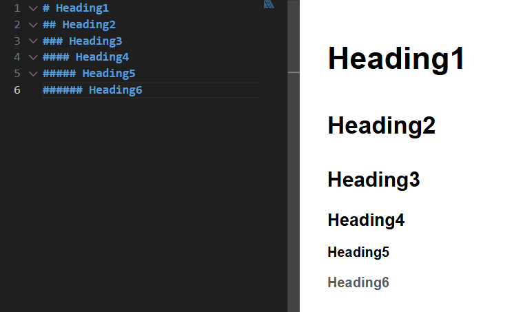
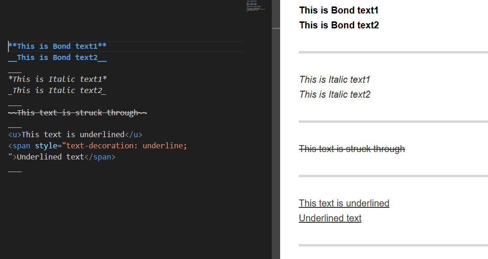
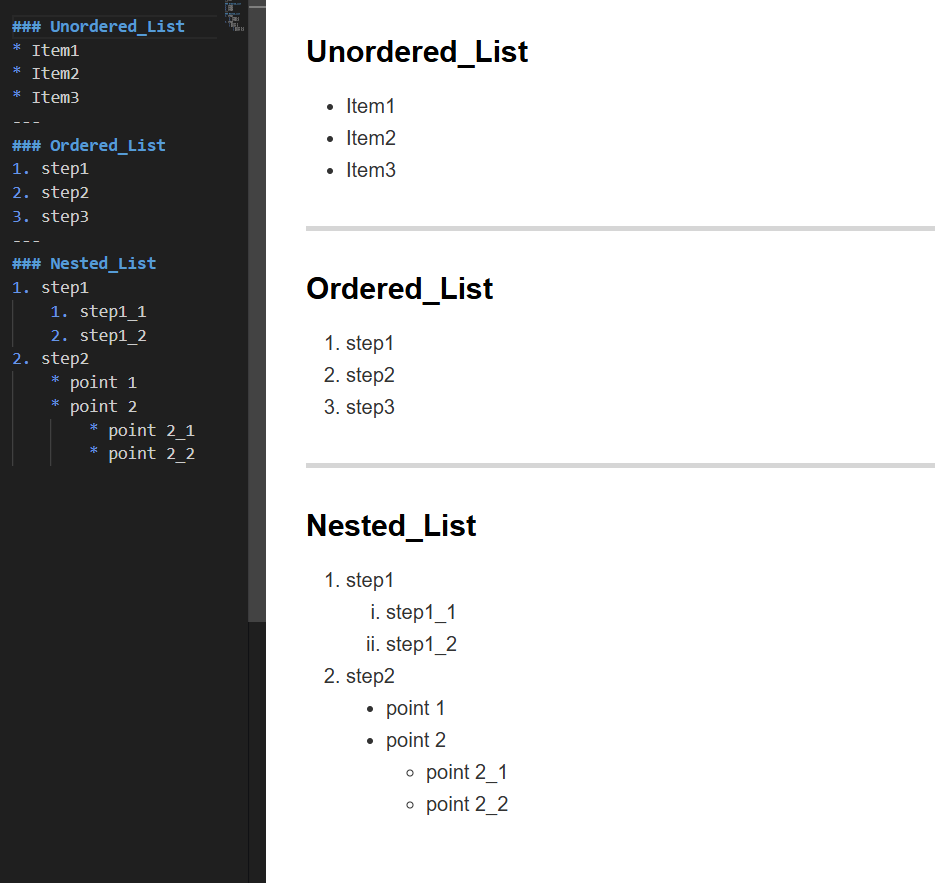

<!--
Note:-
All HTML Tags can be included
Such as <h1>,buttons,<br> and others.
-->

# Markdown Cheat Sheet: Basics
___
## Content:-
1. **[Introduction](#1-what-is-markdown)**
2. **[Heading](#2-heading)**
3. **[Text_Formatting](#3-text-formatting)**
4. **[Horizontal_Lines](#4-horizontal-lines)**
5. **[Lists](#5-lists)**
    1. **[Unorder_Lists](#unordered-lists)**
    2. **[Order_Lists](#ordered-lists)**
    3. **[Nested_Lists](#nested-lists)**
6. **[Links](#6-links)**
7. **[Photos](#7-photos)**
8. **[Blockquotes](#8-blockquotes)**
9. **[Codes](#9-codes)**
10. **[Tables](#10-tables)**
11. **[Task_Lists](#11-task-lists)**
12. **[Collapsible Sections](#12-collapsible-sections-details--summary)**
___
> **Note:**
> 1. All HTML Tags can be included and work seamlessly.
> 2. Please review the code alongside its rendered output to ensure maximum understanding and benefit.
___
## 1. What is *Markdown*
 is a lighweight markup language that allows you to write using an easy-to-read, easy-to-write plain test format, which can then be converted to valid HTML.

**File extension** :-  `.md`

### Why use Markdown?
- **Simplicity:** No need to learn complex HTML tage
- **Compatibility:** Works on almost every platform (GitHub, Reddit)
- **Focus:** Allows you to focus on the Content rather that the design
___
## 2. Heading
 Heading are used to define the structure of your document, making it easier for the reader to navigate through the content.

 ### How to use them?
  You create headings by placing one or more `#` symbols at the beginning of a line.
  The number of `#` symbols determines the level of the heading:
  * #### H1 (Main Title)
    use one `#` symbol
  * #### H2 (Section)
    use two `##` symbols
  * #### H3 (Sub-Section)
    use three `###` symbols

    ### The difference between Headings:
    


 ### Important Rules:
 1. Always ensure there is a space between the **#** symbol and the text
 2. Heading levels range from `H1` to `H6`
 3. Heading levels define the logical structure of your content, not just the font size
 4. there is an old method that named "setext heading". if we place a line of text followed immediately by `---` on the next line, the Markdown parser interprets that text as an `<h1>`(Main Heading) rather than a horizontal line
___
## 3. Text Formatting
 Test formatting allows you to emphasize key points, organize information, and improve readability

 ### Emphasis and Styling
 * **Bold**: To make text stand out, wrap it with double asterisk `**` or  double underscore `__`

 * *Italic*: To add emphasis to a word wrap it with a single asterisk `*` or a single underscore `_`

 * ~~Strikethrough~~: To indicate a correction or removed text, wrap it with double tildes `~~`

 * <u>UnderLine</u>: to make an line under text. unfortunately, In Markdown, there is no standardized, universal syntax to create an underline like there is for bold or italics. For that, we can use HTML `<u> text </u>` or use css `<span style="text-decoration: underline;">Underlined text</span>`

 ### Examples:
  
  ___
  ## 4. Horizontal Lines
  Horizontal rules are used to create a visual break between sections of your document, helping to separate different topics clearly.

  ### we can create it by:
  * using Dashes: `---`
  * using Asterisks: `***`
  * using Underscores: `___`

  ### Important rules:
  * ensure that the line containing the symbols is empty(has no other text)
  * number of symboles mustn't be less than 3  (three or more symbols)
  ___
## 5. Lists
  Lists are essential for organizing information. Markdown supports both unordered and ordered lists.

  * ### Unordered Lists
  Use these for items where the order does not matter

  #### we can create it by:
  * using an asterisk `*`
  * using a dash `-`
  * using a plus sign `+`

  * ### Ordered Lists
  use these for staps or sequences where order is important

  #### we can create it by:
  Start with a number followed by a period.

  * ### Nested Lists
  to create nested lists in markdown, the standard practice is to use 2 or 4 spaces for each level of indentation
  
  ### Example For Lists:
  

  ***Important Rules:***
  * make sure that there is a space between the symbols of Lists and the statement
  * For nested lists, make sure that every level of nested list made with No.tabs
  * It's said that using space bar is safer than using tab, `Tabs can sometimes cause rendering issues across different platforms (like GitHub vs. local viewers).`
___
## 6. Links
  Links are essential for connecting your documentation to external resources or navigating within the same document.

  ### Types of Links :-
  * #### External Links
    To link to a website, place the link text in brackets `[]` followed by the URL in parentheses `()`.
    <br>
    * Syntax: `[google link](https://www.google.com)`
    * Result: [google link](https://www.google.com)
    <br>
  * #### Internal Links (Anchor Links)
    You can link to a specific section within the same file
    <br>
    **Note:-** Markdown generate an ID for every heading automatically (<u>lowercase, spaces replaced by dashes</u>).
    <br>
    * Syntax: `[Go to Heading](#markdown-cheat-sheet-basics)`
    * Result: [Go to Heading](#markdown-cheat-sheet-basics)
    <br>
  * #### Email Links
    You can create a direct link to an email addeess using the `mailto:` Protocol.

    ##### what is mailto: protocol?
      mailto: protocol is a Uniform Resource Identifier (URL) scheme used in HTML to create hyperlinks that automatically open a user's default email client when clicked.
      <br>
    * Syntax: `<mo8729_11@outlook.com>`
    * Result: <mo8729_11@outlook.com>
    <br>
    to change the viewed text
    * Syntax: `[my email](mailto:mo8729_11@outlook.com)`
    * Result: [my email](mailto:mo8729_11@outlook.com)
    <br>
    **Important Rules:** 
    * No spaces: there must be no space between the bracket `[]` and the parenthesis `()`
    * Internal Links: Always ensure your internal anchor link matches your heading title exactly to avoid broken navigation
___
## 7. Photos
  Images are essential for making your documentation more visual and easier to understand.
  it's similar to links but with an Exclamation mark `!` at the beginning & putting the URL or path of photo.

  * Syntax: ``

  **Note:-** `[Alt text]`: a description of the image. this is important for accessibility (screen readers) and displays if the image fails to load.

  ***Important Rules:-***
  * No Spaces: just like links
  * Local paths: if your image is in a folder make sure the path is correct relative to your `.md` file.
  ___
## 8. Blockquotes
  These features are essentail for highlighting notes, citations, or displaying tectnical code snippets.

   1. **Blockquotes**
    use blockquotes to highlight a quote from another source or to draw attention to specific notes.<br><br>

      **syntax:-** 
      * Start the line with a greater-than symbol `>`
      * You can nest blockquotes by using multiple greater-than symbols `>>` `>>>`<br><br>

      **Example:-**
      > This is a blockquote.
      It can span multipe line, As long as there is no `enter` space between the two lines.

      **Note:-** you can include other Markdown elements inside a blockquote (like lists or bold text).
      ___
## 9. Codes
  Markdown offers two ways to display code:inline and blocks.

  * inline Code:- User single backticks (`) to format text as code within a sentence.

    * Example:- `Code here`

  * Code Blocks: use triple backticks(```) at the start and end of the block to display multiple lines of code.
  * there is another way to create it by start with 4 spaces or one tab. but it isn't efficienty like the first way.

    * syntax:-
    ```js
     let variable = 10;
    ```

  * **Notes:-**
    
    * Language Highlighting: add the language name after the first triple backticks for syntax highlighting. For examples:-(python, java, js, vhdl ,..).
    * inline code is best for short commands or file names
    * Ensure the code block is on its own line to render correctly.
    * Remember: Always leave an empty line before starting a code block if you are following a paragraph, otherwise, it might not render as intended.
  ___
## 10. Tables
Tables are used to organize structured data clearly. Markdown uses vertical pipes (`|`) and hyphens (`-`) to create this structure.

### Syntax:
* **Header Row:** Create column names separated by `|`.
* **Delimiter Row:** Use at least three dashes `---` for each column, separated by `|`. This row tells the parser it is a table.
* **Data Rows:** Fill in your content row by row, ensuring the same number of columns as the header.

### Example:
| Name | Age | Major |
| :--- | :---: | ---: |
| Mohamed | 21 | Computer Eng |
| Ali | 22 | Electronics |

### Alignment:
You can control text alignment by adding colons (`:`) in the delimiter row:
* **Left Alignment:** `:---`
* **Right Alignment:** `---:`
* **Center Alignment:** `:---:`

### Important Rules:
* **Pipes:** While not strictly required at the start and end of rows, using them provides better compatibility across different platforms like GitHub.
* **Spacing:** You can add extra spaces to align the pipes in your raw code for better readability; it will not affect the final output.
* **Line Breaks:** Standard Markdown does not support multi-line text inside a table cell. Use `<br>` if you need a line break within a cell.
* **Spacing:** Always ensure there is an empty line before starting a table, or it may not render correctly.
  ___
## 11. Task Lists
Task lists allow you to create a list of items with checkboxes. This is extremely useful for tracking project tasks, especially on platforms like GitHub.

### Syntax:
* Start the list item with a dash `-`, followed by a space, brackets `[ ]` for an uncompleted task, or `[x]` for a completed task.
* **Uncompleted Task:** `- [ ] Task to do`
* **Completed Task:** `- [x] Finished task`

### Example:
- [x] Learn Markdown basics
- [x] Create the cheat sheet document
- [ ] Share it on GitHub

### Important Rules:
* **Case Sensitivity:** Use a lowercase `x` inside the brackets (`[x]`) to check the box. Capital `X` may not work on some renderers.
* **Interactivity:** On platforms like GitHub or local Markdown previewers with checkbox support, you can actually click the checkboxes to check/uncheck them directly.
___
## 12. Collapsible Sections (Details & Summary)
Collapsible sections allow you to hide large blocks of text, code, or explanations behind a clickable summary title. This keeps your documentation clean and prevents clutter.

### Syntax:
Use the HTML `<details>` and `<summary>` tags directly inside your Markdown file:

```html
<details>
<summary>Click here to expand/collapse</summary>

Here is the hidden content, notes, or code blocks that you want to reveal upon clicking!

</details>
```

### Practical Example:
Here is how you can use a collapsible section to hide a long code snippet or detailed explanation:

<details>
<summary>Click here to view the Text</summary>
  Lorem ipsum dolor sit amet consectetur adipisicing elit. Nemo incidunt obcaecati enim eveniet provident! Dicta delectus recusandae corporis, fuga ut reiciendis dolorum. Repudiandae sunt commodi iste debitis corporis dolore. Totam.
</details>

___

### Important Rules:
* **HTML Integration**: Since standard Markdown doesn't have a native collapsible syntax, we rely on HTML tags (&lt;details&gt; and &lt;summary&gt;), which are fully supported on GitHub and most modern Markdown viewers.

* **Spacing**: Always leave an empty line inside the tags before writing your block content to ensure markdown elements (like code blocks or lists) render correctly.
___

```
"Good documentation is like a love letter to your future self."
— Damian Conway
```
___